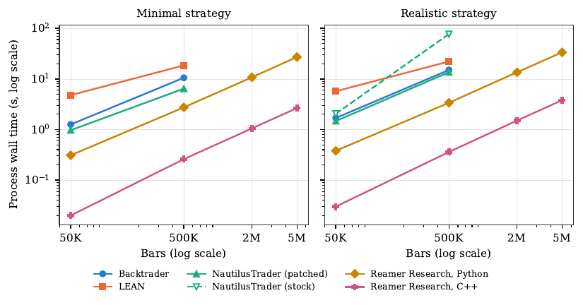
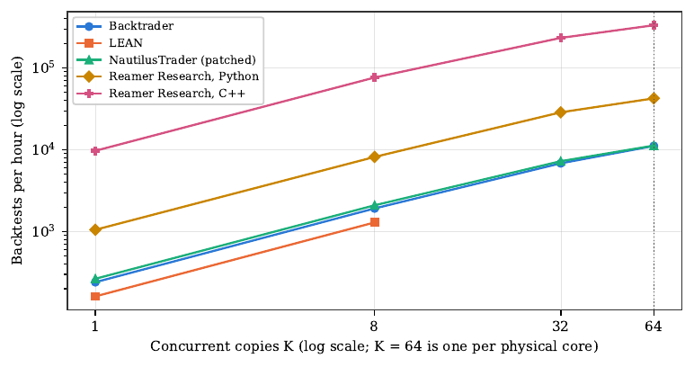

# Backtesting engine benchmark

Backtrader, NautilusTrader, QuantConnect LEAN and Reamer Research: the same
strategies on the same data, on one AMD EPYC 9575F. This repository holds the
runners, the raw results and the script that rebuilds every table.

**Disclosure:** the author builds and sells Reamer Research. Read the results
with that in mind. Four outcomes that would count against it were stated
before any result was seen, and [two of them occurred](#results-against-reamer-research).
The other engines ran at their defaults, with every change [listed](#what-was-changed-from-defaults).

| | |
|---|---|
| Paper | [What a Backtest Costs](https://doi.org/10.6084/m9.figshare.34787745) (preprint) |
| Archived data | [Figshare dataset](https://doi.org/10.6084/m9.figshare.34785729) |
| Run | One bare-metal server, 2026-10-25 |
| Versions | Backtrader 1.9.78.123, NautilusTrader 1.231.0, LEAN f3d841e, Reamer Research 4.6.0 |

## Results

All figures are medians of process wall time and peak memory. The realistic
strategy is a 20-bar Donchian breakout that flips position, with no
commission, spread or slippage. The minimal strategy reads one close per bar
and never trades.

### One backtest, 500,000 bars

| Engine | Realistic | Memory | Minimal | Memory | Marginal rate, realistic |
|---|---:|---:|---:|---:|---:|
| Reamer Research, C++ | 0.36 s | 185 MB | 0.26 s | 153 MB | 1,311,000 bars/s |
| Reamer Research, Python | 3.38 s | 309 MB | 2.74 s | 309 MB | 149,000 bars/s |
| NautilusTrader, patched | 13.61 s | 717 MB | 6.43 s | 603 MB | 37,000 bars/s |
| Backtrader | 15.04 s | 309 MB | 10.54 s | 209 MB | 34,000 bars/s |
| LEAN | 22.10 s | 1,126 MB | 18.52 s | 617 MB | 27,000 bars/s |
| NautilusTrader, stock | 76.85 s | 739 MB | 6.54 s | 602 MB | not linear, see below |

LEAN also has a fixed start of 3.3–3.9 s per run. The other engines start in
under 0.4 s.



### Many tickers, 35,064 bars each, realistic strategy

| Engine | 10 tickers | 50 tickers | 100 tickers | Memory at largest run |
|---|---:|---:|---:|---:|
| Reamer Research, Python | 1.55 s | 7.74 s | 14.85 s | 942 MB |
| Backtrader | 9.56 s | 46.80 s | 94.82 s | 1,190 MB |
| LEAN | 18.50 s | 83.51 s | cut for budget | 1,812 MB |
| NautilusTrader, patched | 57.76 s | 319.12 s | 675.92 s | 4,710 MB |

The Reamer Research breadth runner is Python only. LEAN's times are for the
attempt that succeeded; see [LEAN start-up hangs](#lean-start-up-hangs).

### A parameter sweep, 64 copies at once

| Engine | Backtests per hour | Efficiency | Summed memory | € per 1,000 backtests |
|---|---:|---:|---:|---:|
| Reamer Research, C++ | 332,249 | 0.53 | 11.9 GB | 0.0085 |
| Reamer Research, Python | 42,468 | 0.63 | 19.7 GB | 0.067 |
| NautilusTrader, patched | 11,242 | 0.66 | 45.8 GB | 0.25 |
| Backtrader | 11,125 | 0.72 | 19.7 GB | 0.25 |
| LEAN, at 8 copies | 1,293 | 1.00 | 7.6 GB | 2.19 |

LEAN completed 1 and 8 copies. At 32 copies all 32 stalled at start, and
64 copies were not run. Cost is hardware only, at the server's €2.83 per hour.



### Do the engines agree?

All engines made the same trades at 500,000 bars, to within one closing fill.
Net PnL differs because they fill at different prices:

| Engines | Net PnL | Fill price |
|---|---:|---|
| LEAN, NautilusTrader | −1,981.89 | Current bar |
| Backtrader | −1,956.83 | Next bar's open |
| Reamer Research | −1,937.16 | Next bar, first tick of a seeded path |

Repricing the Reamer Research fills at the open reproduces Backtrader's figure
exactly. Every completed run of every engine repeated its result. The Reamer
Research ledger was also bit-identical over 20 runs on one build. The other
engines were compared on PnL and counts only.

## Results against Reamer Research

- **Backtrader used less memory than the Reamer Research Python path** above
  about 270,000 bars of the minimal strategy: 209 MB against 309 MB at
  500,000 bars, and 513 MB against 739 MB at 100 tickers.
- **The Reamer Research C++ path had the lowest parallel efficiency**: 0.53 at
  64 copies, against 0.63–0.72 for the others. Its throughput was still
  rising. The cause was not measured.

## Findings in other engines

Each of these is an observation from this run, on these versions.

### NautilusTrader

- `record_trade` cost grows with the square of the trade count (exponent
  2.03), and took 85% of engine time at 500,000 bars. This was already
  reported upstream as [#4434](https://github.com/nautechsystems/nautilus_trader/issues/4434),
  closed as not planned. The maintainers state that 2.0 fixes it. No 2.0
  release candidate was tested. On 2026-11-04, 1.231.0 was still the latest
  stable release on PyPI.
- A multi-instrument cost sits in `Portfolio._ensure_snapshot_pnls_cached_for`
  on NETTING accounts. No matching upstream report was found as of 2026-10-26.

### LEAN start-up hangs

14 of 22 multi-ticker attempts hung at start, and the retry runner killed and
restarted them. None of 11 runs on a laptop hung. 3 of 6 hung when repeated on
the idle server. This is observed behaviour, not a confirmed LEAN bug; the
reproduction is in [`lean-deadlock/`](lean-deadlock/).

Two early LEAN problems were errors in this configuration, not faults in LEAN:
custom data defaulting to New York time, and an end date set too early. Both
are fixed in the single-ticker figures. The breadth algorithm keeps the
time-zone setting, which drops 8 bars per ticker.

## What the benchmark does not show

- It is one machine, one date and one instrument, with two strategy shapes.
- Most of the time here is engine overhead, because the strategies are small.
  Heavy indicators or a model in the loop narrow the differences.
- Engines ran at defaults. A tuned configuration could change the result.
- Speed is one property. LEAN has the broadest asset, data and order model and
  a hosted live path. NautilusTrader has a rich order and data model, built-in
  live adapters and one code path for backtest and live. Backtrader is pure
  Python, free and easy to change. Reamer Research has a small native order
  set, runs on bars with simulated intrabar ticks, and is closed source and
  paid.

Tuned configurations and replications on other hardware are welcome. Open an
issue with your settings, versions and raw results.

## What was changed from defaults

- **NautilusTrader:** `nautilus_p` turns `record_trade` off. Both stock and
  patched rows are published. `NAUTILUS_PATCH_RECORD_TRADE=1` applies it.
- **LEAN:** run as the open-source engine through `dotnet exec`, built from
  source, with custom data re-anchored to 2000-01-01 because LEAN stops at the
  current date. The LEAN CLI needs a signed-in account and a paid plan for
  local coding; the engine does not.
- **Input data:** 58,942 GBP/USD 15-minute bars, tiled end to end into each
  tier. Portfolio tickers are rescaled windows of the same series.
- Each runner's header comment states its remaining settings.

## Run it

Rebuild every table from the raw results, with no dependencies:

```sh
python3 code/analysis/analyze_final.py results
```

Rerun Backtrader and NautilusTrader. The published input is not redistributed,
so this uses a synthetic series. Timings depend on your machine, and trade
counts and PnL will not match the published ones.

```sh
python3.13 -m venv .venv
.venv/bin/pip install backtrader==1.9.78.123 nautilus-trader==1.231.0 pandas numpy
mkdir -p data
PY=.venv/bin/python
$PY code/bench_runners/make_synthetic_base.py data/base.bin
$PY code/bench_runners/build_dataset.py data/base.bin 500000 data/t500000.bin bin
$PY code/bench_runners/build_dataset.py data/base.bin 500000 data/t500000.pkl pkl

$PY code/bench_runners/backtrader_runner.py data/t500000.pkl realistic
NAUTILUS_PATCH_RECORD_TRADE=1 $PY -W ignore code/bench_runners/nautilus_runner.py data/t500000.bin realistic
```

Each runner prints one JSON line. Wrap it in GNU `time -v` for wall time and
peak memory, as the published runs did.

- **LEAN** needs a source build, .NET 10 and QuantConnect's pinned Python 3.11.
  The steps are in the header of [`lean_runner.py`](code/bench_runners/lean_runner.py).
  The script looks for the engine at `../tests/stress/lean_engine` relative to
  this directory.
- **Reamer Research** needs the library from the 30-day trial kit at
  [reamerlabs.com](https://reamerlabs.com). No binary is in this repository.

## What is here

| Path | Contents |
|---|---|
| `results/fourway.jsonl`, `fourway_rerun.jsonl` | Single-ticker runs, 50K to 5M bars |
| `results/portfolio.jsonl`, `portfolio_rerun.jsonl` | 10, 50 and 100 tickers |
| `results/parallel.jsonl` | 1, 8, 32 and 64 copies, with a batch summary row |
| `results/determinism.jsonl` | 20 runs each of the Python ledger hash and the C++ runner |
| `results/open_fill_sensitivity.jsonl` | Fills repriced at the open. Laptop run, PnL only |
| `results/fourway_f01_attempt1.jsonl` | Aborted first attempt. Not used |
| `results/steps.jsonl` | Harness steps, mid-run patches and budget cuts |
| `results/provenance.txt` | Machine, OS, compiler and every package version |
| `code/bench_runners/` | Dataset builders and one runner per engine and workload |
| `code/lean_project/` | LEAN algorithms and config template |
| `code/analysis/` | `analyze_final.py` rebuilds the tables |
| `lean-deadlock/` | Hang reproduction scripts and output |
| `SHA256SUMS` | Checksums, matching the Figshare archive |

Only `README.md`, `CITATION.cff`, `LICENSE`, `.gitignore`, `docs/`,
`code/bench_runners/make_synthetic_base.py` and
`code/lean_project/LICENSE-APACHE-2.0.txt` were added here. Everything listed
in `SHA256SUMS` is byte-identical to the archive.

**Reading the JSONL.** Each run row has `suite`, `variant` (`reamer_cpp`,
`reamer_py`, `backtrader`, `nautilus`, `nautilus_p`, `lean`), `strategy`, the
tier (`tier` or `n_tickers`), `rep`, `rc`, `ok`, `outer_wall_s` and
`outer_max_rss_mb` from GNU `time`, and the runner's own `run_s`, fill and
trade counts, `net_pnl` and `peak_rss_mb`.

**Which rows count.** `analyze_final.py` applies these rules. Originals are
kept unedited.

- `fourway_rerun.jsonl` replaces LEAN and `reamer_py` rows at 50K and 500K.
- `portfolio_rerun.jsonl` replaces all `reamer_py` rows and the LEAN 10-ticker
  realistic rep 1 row, which hung and was killed.
- Rows with `skipped: cut by the operator` were cut for budget. They are
  excluded, not counted as failures.
- LEAN breadth wall time is the successful attempt's `run_s`, because
  `outer_wall_s` includes killed attempts.

Server paths were replaced with `<workdir>/` and `<home>/`, and the host name
with `<host>`. One Python traceback was removed from
`open_fill_sensitivity.jsonl`. No values were changed.

## Environment

AMD EPYC 9575F, 64 cores and 128 threads, 1 NUMA node, 755 GiB. Ubuntu 26.04.1,
kernel 7.0.0-38-generic, `performance` governor, boost and SMT on. GCC 15.2.0.
Python 3.13 for all engines except LEAN, which runs Python 3.11 through
Python.NET.

## Cite

Palghadmal, C. (2026). *What a Backtest Costs: Throughput, Memory, Scaling and
Reproducibility of Four Backtesting Engines on a 64-Core CPU*. Reamer Labs.
https://doi.org/10.6084/m9.figshare.34787745

## Licence

[CC BY 4.0](LICENSE), matching the archive. The LEAN-derived files in
`code/lean_project/` (`AlgorithmImports.py`, `PandasMapper.py`, `clr.py` and
`config.template.json`) remain under the
[Apache License 2.0](code/lean_project/LICENSE-APACHE-2.0.txt).
